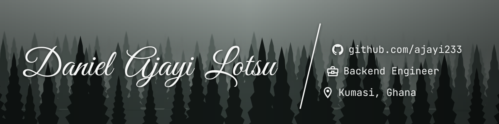

  

  
  
  

  " />

  My name is Daniel Ajayi Lotsu, a backend engineer from Ghana. I build APIs and services with Node.js, NestJS and PostgreSQL at AmaliTech, where I also mentor backend trainees. I'm AWS certified (Developer – Associate) and spend a lot of my time on observability and mobile money integrations. In my spare time, I play FIFA and redesign my room.

<h2 align="center">Tech Stack</h2>

  
   
  

<h2 align="center">Statistics</h2>

  
  

<h3 align="center">With ❤️ from Ghana 🇬🇭</h3>
# ajayi233
